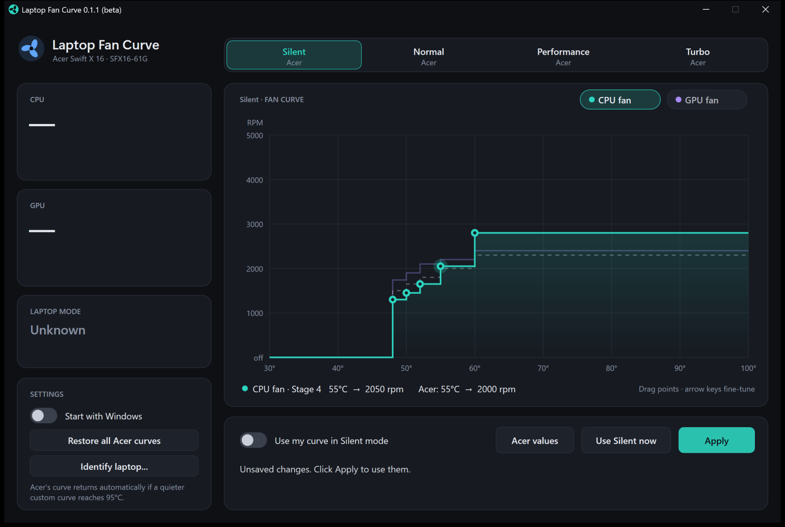

# Laptop Fan Curve

Custom fan curves for Windows laptops, with a drag-and-drop curve editor.

   

Laptop Fan Curve lets you draw your own temperature-to-fan-speed curve for each fan, and for each
vendor performance mode where the laptop supports it. It was built for the **Acer Swift X 16
(SFX16-61G)**, where no existing fan tool worked. The **Identify** feature helps you set up other
laptops.



> **Before you start:** install **[PawnIO](https://pawnio.eu)** (free). The app needs this driver to reach
> the fans and won't work without it. If PawnIO is missing, the app shows a **Setup needed** card with a
> download button. See [Requirements](#requirements).

> **Use at your own risk.** This app writes to your laptop's embedded controller, the chip that runs
> the fans. Wrong settings can make a laptop run hot or loud. The app has safety checks (see
> [Safety](#safety)), but it is not affiliated with or endorsed by Acer or any laptop manufacturer.

## Features

- A **fan curve editor**. Drag points, or fine-tune with the arrow keys. It shows a separate CPU and GPU fan
  curve, the vendor default as a dashed line, and a live "now" marker.
- **Per-mode curves.** On supported Acer laptops, Silent, Normal, Performance and Turbo each keep their own curve.
- **Live sensors.** CPU and GPU temperature, fan speed, and 3-minute history graphs.
- It **stays applied**. The app re-applies your curve after mode switches and sleep, and runs from the tray.
- It can **start with Windows** without a UAC prompt.
- **Identify** for other laptops. It reads the laptop's firmware description and either:
  - finds Acer-style fan tables in the manufacturer's BIOS update file, or
  - imports your model's [NoteBook FanControl](https://github.com/hirschmann/nbfc) config.
- A **report export** for unsupported laptops, so support can be added.

## Supported laptops

| Laptop | How it works | Status |
|---|---|---|
| Acer Swift X 16 SFX16-61G, BIOS 1.56 | Built in. Writes the fan tables the embedded controller already uses. | **Tested** in Silent mode. Normal, Performance and Turbo are checked against the laptop automatically the first time they are used. |
| Other Acer laptops with the same fan-controller family | Identify, then choose the BIOS update file. | **Experimental.** Untested, testers wanted. |
| Laptops with a NoteBook FanControl config | Identify, then import the model's NBFC config. | Untested, needs testers |
| Desktop PCs | Not supported. Use [Fan Control](https://getfancontrol.com). | n/a |

## Requirements

1. **Windows 10 or 11, 64-bit**, and an administrator account. The app asks for elevation.
2. **[PawnIO](https://pawnio.eu)**, a signed driver for hardware access. Install it with
   [PawnIO_setup.exe](https://github.com/namazso/PawnIO.Setup/releases/latest/download/PawnIO_setup.exe).
   The required PawnIO module `LpcACPIEC.bin` is included in the download.
3. Optional: **[7-Zip](https://www.7-zip.org)**, so Identify can unpack BIOS update installers by itself.

## Install

1. Install PawnIO (see above).
2. Download `LaptopFanCurve-<version>-win-x64.zip` from [Releases](../../releases) and extract it to
   a folder you keep, for example `C:\Program Files\LaptopFanCurve`.
3. Run `LaptopFanCurve.exe`. Keep `LpcACPIEC.bin` in the same folder.

Windows SmartScreen may warn you, because the app is not code-signed. Choose **More info → Run anyway**,
or build it yourself from source.

## Using it

- **Tabs** choose which vendor mode you are editing. **Use \<mode\> now** switches the laptop to that mode.
- **Drag points** on the chart. Each point is a fan stage: when the temperature reaches the point, the fan
  steps to that speed. Click a point and use the arrow keys: left/right change the temperature by 1 °C, up/down change the speed by 50 RPM (Acer) or 1% (NBFC). Tab selects
  the next point.
- **Apply** saves the curve and turns it on. The switch next to it turns your curve on or off.
- **Acer values** / **Config values** loads the defaults back into the editor.
- With a custom curve on, closing the window keeps the app running in the tray.

### Setting up another laptop (Identify)

Open **Identify laptop...** in Settings. The app opens there automatically on an unknown laptop.

1. **Scan** reads the model, the ACPI firmware tables and the vendor WMI interfaces. It never writes anything.
2. **Find the fan settings**:
   - **Acer:** click **BIOS file...** and choose the BIOS update downloaded from Acer's support site for
     your exact model. The app finds the fan tables in it. The file is read, never run. A definition is only
     created when the laptop's fan controller has the same layout as the verified Acer family; other laptops
     get a report instead.
   - **Other brands:** click **How?**. Then download your model's config from the
     [NBFC configs](https://github.com/hirschmann/nbfc/tree/master/Configs) (or
     [nbfc-linux configs](https://github.com/nbfc-linux/nbfc-linux/tree/main/share/nbfc/configs)), and
     click **NBFC config...**. The model name must match your laptop.
3. **Use** saves the definition.
4. **Confirm** reads the fan controller once and checks it. Curves can only be applied after this.
   Confirmation is stored on your laptop only. A definition file shared by someone else always has to be
   confirmed again. On Acer models other than the SFX16-61G, Confirm is **experimental**: a matching firmware
   layout is a strong sign, not proof, that the fan controller works the same way. Confirm reads the first
   10 bytes and stops immediately if they don't look like a fan table. These models are labelled
   "experimental" in the app.

If nothing works, click **Save report...** and attach the report to a
[new issue](../../issues/new). Reports contain your laptop's model, its firmware's fan and temperature
fields, and its WMI class names. They contain no personal files.

## Safety

- The app checks each vendor table against the live fan controller before it ever writes to it. If the check
  fails, custom curves stay disabled for that mode.
- **Acer laptops:** your curve is written into the fan controller's own table, so the laptop's firmware
  keeps running the fans. While the app is running and your curve cools less than Acer's, it restores
  Acer's curve if the CPU or GPU reaches 95 °C, or if temperature readings stop for about 10 seconds.
  If the app is closed or crashes, your curve stays in place until a reboot or a mode switch. The laptop's
  built-in thermal protection (CPU/GPU throttling) still applies. A reboot, or **Restore all Acer curves**,
  always brings back the factory curves.
- **NBFC laptops:** the app runs the curve itself, like NBFC does. Above the config's critical temperature
  the fans run at 100%. If the temperature reading is lost, the app hands the fans back to the firmware,
  and it does the same whenever the app closes. Turning a config on asks for consent once per config file.
  If the config's model name differs from your laptop's, you must also tick an "I am sure" box.
- Five fan-controller errors in a row turn the custom curve off.

## Troubleshooting

If the app can't reach the fan controller, it shows a **Setup needed** card instead of the controls.

| Message in the app | What to do |
|---|---|
| **Setup needed: install PawnIO** | Install [PawnIO](https://pawnio.eu), then click **Check again**. The app also keeps checking by itself. |
| **PawnIO is installed but its driver is not running** | Restart Windows once after installing PawnIO. If it keeps happening, reinstall the latest PawnIO. |
| **LpcACPIEC.bin is missing** | Keep `LpcACPIEC.bin` from the download zip in the same folder as `LaptopFanCurve.exe`. |
| **PawnIO did not accept its module** | Update PawnIO to the latest version. |
| "7-Zip is not installed" (Identify) | Install [7-Zip](https://www.7-zip.org), or extract the BIOS `.fd`/`.bin` image yourself and choose that file. |
| The laptop opens on the Identify screen | It isn't a known model yet. Follow [Setting up another laptop](#setting-up-another-laptop-identify). |
| The fans don't respond after Apply | Check `%LOCALAPPDATA%\LaptopFanCurve\log.txt`, and open an issue with your Identify report. |

Only one fan tool should control the fans at a time. Close NoteBook FanControl, Fan Control and similar tools
before using this app.

## Building from source

Requires Visual Studio 2022 or later with the "Desktop development with C++" workload.

```
build.cmd
```

The script builds `bin\LaptopFanCurve.exe`, copies the PawnIO module next to it, and creates the
release zip in `dist\`. `tests\run_tests.cmd` runs the hardware-independent tests (NBFC rules,
BIOS table scanner, model definitions, and the safety logic under simulated failures). GitHub Actions runs both on every push. See
[docs/TECHNICAL.md](docs/TECHNICAL.md) for how the app works.

## Contributing

Testers with other Acer laptops or NBFC-supported laptops are the most useful help right now. Open
an issue with your Identify report, and say what worked and what did not.

## License

MIT. See [LICENSE](LICENSE). The bundled PawnIO module is LGPL-2.1; see
[THIRD-PARTY-NOTICES.md](THIRD-PARTY-NOTICES.md).

Acer, AcerSense and Swift are trademarks of Acer Inc. This project is independent and is not
affiliated with or endorsed by Acer.
